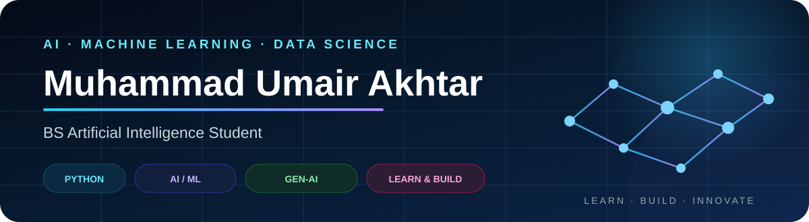
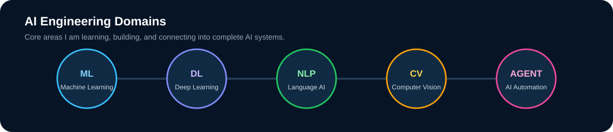
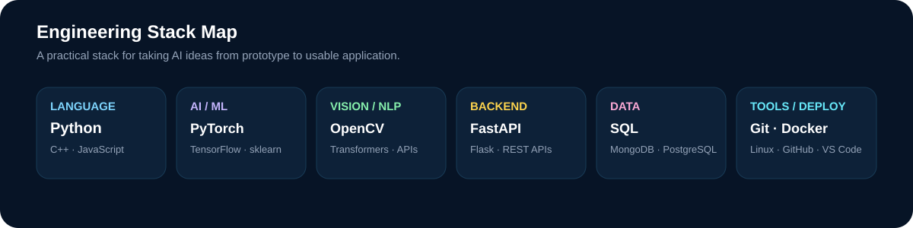

<p align="center">
  
</p>

<div align="center">
<h3>AI/ML Developer • Machine Learning • Deep Learning • NLP • LLMs
</p>

<p align="center">
<strong>Building intelligent, practical, and scalable AI applications with Generative AI, RAG & LangChain.
<p align="center">
  <a href="https://linkedin.com/in/umairakhtar-ai">
    
  </a>
  <a href="mailto:umairakhtar104db@gmail.com">
    
  </a>
  <a href="https://umair104db.github.io/">
    
   </a>
  <a href="assets/Muhammad_Umair_Akhtar_CV_Final.pdf">
    
  </a>
</p>

<p align="center">
  
  
</p>

</div>

---

## 👋 About Me

I am an **AI/ML Developer** passionate about designing and developing intelligent software solutions that combine **machine learning, deep learning, natural language processing, and modern Generative AI technologies**.

My current focus is on building applications powered by **Large Language Models (LLMs), Retrieval-Augmented Generation (RAG), LangChain, and AI Agents**, with an emphasis on practical use cases and real-world problem solving.

I enjoy working across the complete AI development lifecycle — from **data preparation and exploratory analysis to model development, evaluation, and intelligent application development**.

### What I Do

* 🤖 Develop **Machine Learning & Deep Learning** solutions
* 🧠 Explore **NLP and Large Language Models**
* ✨ Build **Generative AI applications**
* 🔎 Design **Retrieval-Augmented Generation (RAG)** workflows
* 🔗 Develop LLM applications using **LangChain**
* 🧩 Explore **AI Agent architectures**
* 📊 Perform **data analysis, visualization, and feature engineering**
* 🌐 Integrate AI capabilities into **modern web applications**

---

## 🎯 Current Focus

<table>
<tr>
<td width="50%">

### 🔭 Currently Working On

**Generative AI, LLMs, RAG & LangChain**

Building intelligent AI-powered applications and exploring practical LLM use cases.

</td>

<td width="50%">

### 🌱 Currently Learning

**Advanced Generative AI, LLM Applications, RAG & AI Agents**

Continuously expanding my understanding of modern AI application development.

</td>
</tr>

<tr>
<td width="50%">

### 🤝 Open to Collaboration

**AI/ML & Generative AI Projects**

Especially projects focused on solving meaningful real-world problems.

</td>

<td width="50%">

### 💬 Ask Me About

**Machine Learning • Deep Learning • NLP • LLMs • RAG • LangChain**

</td>
</tr>
</table>

---

## 🧠 Areas of Expertise & Interest

<div align="center">

| Artificial Intelligence |   Machine Learning  |   Generative AI  |
| :---------------------: | :-----------------: | :--------------: |
|     AI Applications     | Supervised Learning | LLM Applications |
|      Deep Learning      | Feature Engineering |        RAG       |
|           NLP           |   Model Evaluation  |     LangChain    |
|     Neural Networks     |    Data Analysis    |     AI Agents    |

</div>

---

## 🚀 Featured Projects

<table>
<tr>
<td width="50%" valign="top">

### 📊 Data Analysis Project

A data analysis project that represents my practical work with data and Python tools.


</td>
<td width="50%" valign="top">

### 🧾 KhataFlow

A shop management and khata workflow project. The project direction includes managing shop information and business workflows.


</td>
</tr>
<tr>
<td width="50%" valign="top">

### 🧠 AI Projects

AI projects are in progress as I continue learning and building practical experience in artificial intelligence and machine learning.


</td>
<td width="50%" valign="top">

### 🌐 Portfolio

Explore my portfolio to see my projects, skills, and journey in AI and software development.

[](https://umair104db.github.io/portfolio/)

[](assets/Muhammad_Umair_Akhtar_CV_Final.pdf)

</td>
</tr>
</table>

---

## 🧠 AI Engineering Domains

<p align="center">
  
</p>

---

# 🛠️ Technology Stack

## 🐍 Programming

<p>
  
  
  
  
  
</p>

## 🤖 AI • Machine Learning • Data Science

<p>
  
  
  
  
  
  
</p>

## ✨ Generative AI • LLMs

<p>
  
  
  
  
  
</p>

## 🌐 Web Development

<p>
  
  
  
  
  
  
  
  
  
</p>

## 🗄️ Databases

<p>
  
  
  
  
</p>

## ⚙️ Tools & Platforms

<p>
  
  
  
  
  
  
</p>

---

# 📌 Featured Work

> A selection of projects demonstrating my work across AI, machine learning, data science, and software development.

### 🤖 Generative AI & LLM Applications

**Coming soon — building and documenting practical Generative AI projects.**

Projects will focus on areas such as:

* Large Language Model applications
* Retrieval-Augmented Generation
* Intelligent document processing
* AI-powered assistants
* LangChain workflows
* AI Agent systems

### 📊 Machine Learning & Data Science

Projects exploring:

* Data cleaning & preprocessing
* Exploratory Data Analysis
* Feature engineering
* Regression & classification
* Model evaluation & comparison
* Data visualization

### 🌐 Software & Web Applications

Projects combining software engineering with modern web technologies, databases, and AI capabilities.

---

# 📈 GitHub Analytics

<div align="center">


</div>

<br/>

<div align="center">


</div>


## 🛠️ Engineering Stack

<p align="center">
  
</p>

---

## 📊 Contribution Activity

<div align="center">


</div>

---

# 🧭 My Development Journey

```text
Machine Learning
       ↓
Deep Learning
       ↓
Natural Language Processing
       ↓
Large Language Models
       ↓
Generative AI
       ↓
RAG & LangChain
       ↓
Intelligent AI Applications
       ↓
AI Agents & Production-Ready Solutions
```

---

# 🤝 Let's Connect

I'm always interested in connecting with developers, AI/ML enthusiasts, researchers, and people working on meaningful technology.

<div align="center">

<a href="https://linkedin.com/in/umairakhtar-ai">
  
</a>

<a href="mailto:umairakhtar104db@gmail.com">
  
</a>

</div>

---

<div align="center">

### 🚀 Building with AI. Learning continuously. Solving real-world problems.

**Thanks for visiting my GitHub profile.**

<i>Explore my repositories to see what I'm building.</i>

</div>
